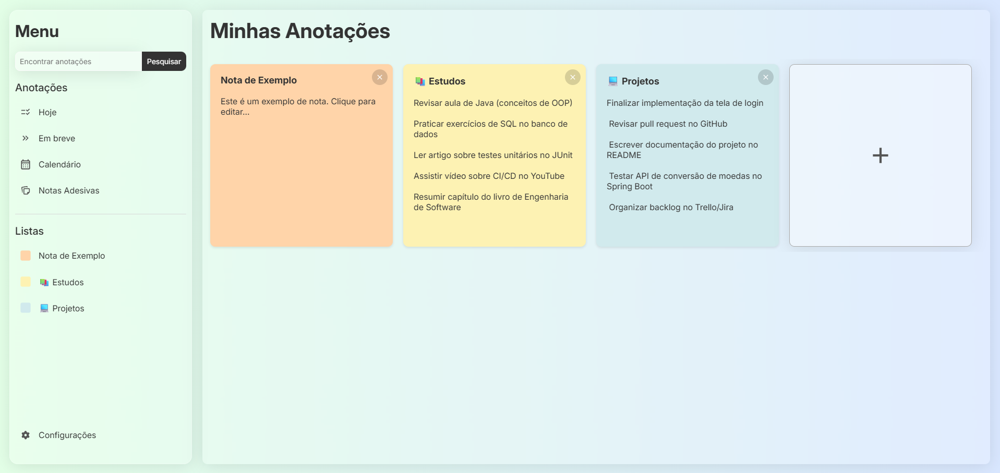

# MyNotes


 <!-- Substitua por um screenshot real do app no GitHub -->

## Acesse o deploy em [MyNotes](https://brennohs.github.io/lista-de-afazeres/)!

## Descrição

Este é um aplicativo web simples de notas adesivas (sticky notes) que permite aos usuários criar, editar, remover e persistir notas diretamente no navegador. <br> 

O app possui uma interface intuitiva com uma sidebar para navegação e uma área principal para exibir as notas em formato de cartões coloridos.

O projeto foi desenvolvido usando tecnologias web nativas (HTML, CSS e JavaScript), sem dependências externas ou frameworks, tornando-o leve e fácil de executar.

## Funcionalidades

- **Criação de Notas**: Clique no botão "Adicionar Nota" para criar uma nova nota com cor de fundo aleatória (amarelo, azul, rosa ou laranja).
- **Edição de Notas**: Títulos e conteúdos são editáveis diretamente nos cartões (usando `contentEditable`). Limites: títulos até 15 caracteres, conteúdos até 400 caracteres.
- **Remoção de Notas**: Botão de fechar em cada nota para removê-la.
- **Menu Lateral**: Lista dinâmica de notas com ícones coloridos correspondentes. Atualiza automaticamente ao editar títulos.
- **Barra de Pesquisa**: (Não implementada funcionalmente no código atual, mas o HTML/CSS está preparado para expansão).
- **Avisos de Limite**: Pop-ups temporários para alertar sobre limites de caracteres.
- **Colar sem Formatação**: Suporte para colar texto simples sem estilos.
- **Design Responsivo e Estético**: Efeitos de vidro (glassmorphism) nos elementos, scroll suave e animações sutis.

## Tecnologias Usadas

- **HTML5**: Estrutura da página e elementos interativos.
- **CSS3**: Estilização com flexbox, glassmorphism (usando backdrop-filter), animações keyframes e hover effects.
- **JavaScript (Vanilla)**: Lógica de criação/edição/remoção de notas, aleatorização de cores, manipulação do DOM, eventos (input, blur, click, load).
- **Ícones**: SVG personalizados (ex: close_icon.svg, yellow_rectangle.svg, etc.).
- **Fontes**: Família 'Inter'.

Nenhuma biblioteca externa é usada, garantindo compatibilidade ampla com navegadores modernos.

Nenhuma instalação de dependências é necessária, pois é um projeto estático.

## Estrutura do Projeto

```
lista-de-afazeres/
├── index.html          # Página principal HTML
├── script.js           # Lógica JavaScript (criação de notas, eventos)
├── style.css           # Importa outros CSS
├── main_content.css    # Estilos para a área principal (notas, cartões)
├── sidebar_content.css # Estilos para a sidebar (menu, botões)
├── icons/              # Pasta com ícones SVG (ex: close_icon.svg, yellow_rectangle.svg)
└── bg-image/           # Pasta com imagem de fundo (background.png)
```

- **HTML**: Define a estrutura com `.container`, `.sidebar` e `.main-content`.
- **CSS**: Separado em módulos para sidebar e main content, com import no `style.css`.
- **JS**: Funções principais: `createNote()`, `updateEditableNotes()`, `showLimitWarning()`.

## Layout

Você pode visualizar o layout do projeto através [desse link](https://www.figma.com/design/e1wBYiy2BjeyWV2XIGRwy9/Untitled?node-id=0-1&t=gPqwDlXoqjI5bqj4-1). É necessário ter conta no [Figma](https://figma.com) para acessá-lo.

## Licença

Este projeto está licenciado sob a [MIT License](LICENSE). Sinta-se à vontade para usar, modificar e distribuir.

## Créditos

- Desenvolvido por Brenno e Luan.
- Ícones e imagens: Google Fonts.
- Inspiração: Aplicativos de notas como Google Keep ou Apple Notes.

Se tiver dúvidas ou issues, abra uma issue no GitHub!
